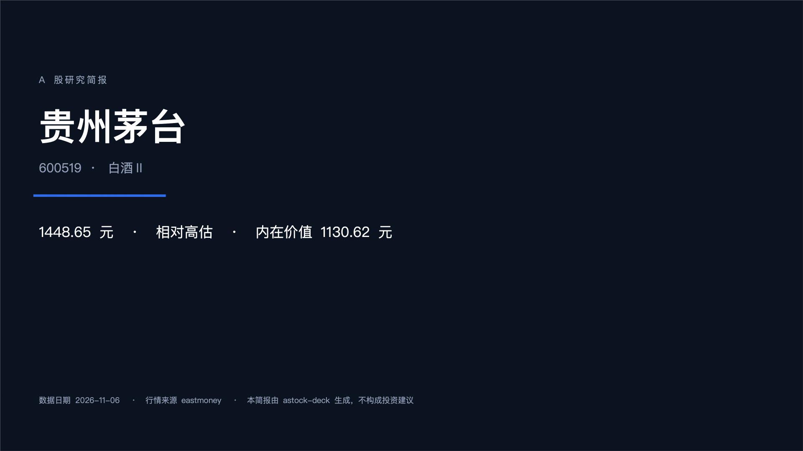
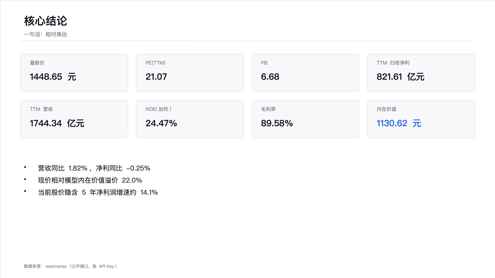
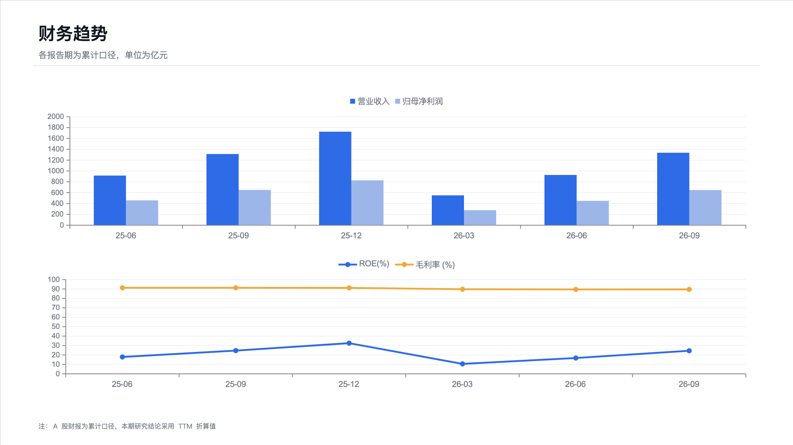

# astock-deck · A 股数据 → 原生 PPTX

> 一条命令，把一只 A 股的数据变成**可编辑的** PowerPoint 研究简报。
> 不是截图拼贴，不是 HTML 转换——文字是文字，表格是表格，图表是 PowerPoint 原生图表，你可以直接改。



```bash
npx @wilshi/astock-deck 600519
# → 600519-研究简报.pptx（6 页，222 KB）
```





> 上面三张图是**程序真实生成的 PPTX 经渲染截图**，不是设计稿。

## 为什么是「原生 PPTX」

现有很多 AI 生成 PPT 的方案实际产出的是**图片拼接**或 **HTML 转换**：

| 方案 | 能改吗 | 问题 |
| --- | --- | --- |
| 截图拼贴 | 不能 | 一个字都改不了 |
| HTML → PDF → PPT | 勉强 | 图表是死的，字体错位 |
| **原生 PPTX** | **可以** | 图表能重新指向你自己的数据 |

`astock-deck` 走的是第三条路：用 [pptxgenjs](https://github.com/gitbrent/PptxGenJS) 直接构造 OOXML。产出的 `.pptx` 在 Keynote、WPS、Office 里都能正常打开和编辑，图表是真正的图表对象。

## 生成什么

| 页 | 内容 |
| --- | --- |
| 1 | 封面：公司名、代码、行业、一句话结论 |
| 2 | 核心结论：8 个关键指标卡片 + 要点 |
| 3 | 财务趋势：营收/净利柱状图 + ROE/毛利率折线图（原生图表） |
| 4 | 估值测算：模型选择、TTM 口径、假设、内在价值与隐含增速 |
| 5 | 价格走势：120 个交易日收盘价折线 |
| 6 | 风险提示与免责声明 |

## 快速开始

```bash
# 直接生成默认简报
npx @wilshi/astock-deck 600519

# 指定输出与估值假设
npx @wilshi/astock-deck 600519 -o 茅台.pptx --discount 0.12 --growth 0.10

# 生成后直接打开（macOS）
open 600519-研究简报.pptx
```

| 选项 | 默认 | 说明 |
| --- | --- | --- |
| `-o, --out` | `<代码>-研究简报.pptx` | 输出路径 |
| `--growth` | 0.08 | DCF 前 N 年净利润增速 |
| `--terminal` | 0.025 | 永续增速 |
| `--discount` | 0.10 | 折现率 / 要求回报率 |
| `--years` | 5 | 显式预测年数 |
| `--bars` | 120 | 走势图取的交易日数 |

## 估值模型会自己选

| 公司类型 | 模型 |
| --- | --- |
| 一般盈利公司 | 两阶段 DCF |
| 银行 / 保险 / 证券 | PB-ROE（`合理 PB = (ROE - g) / (r - g)`） |
| 亏损公司 | 标注不适用 |

对银行套 DCF 会算出荒谬的「安全边际」，所以金融股会自动切换模型。TTM 也不是直接取最近一期——A 股财报是累计口径，按 `最新累计 + 上年年报 - 上年同期` 折算。

## 数据从哪来

公开接口，**不需要 API Key**，与 [cnstock](https://github.com/WilShi/cnstock) 共用同一套数据层：

| 能力 | 主源 | 备用 |
| --- | --- | --- |
| 行情 / 估值 | 东方财富 | 腾讯 → 新浪 |
| 日 K 线 | 东方财富 | 腾讯 |
| 财报 | 东方财富 datacenter | — |

为什么要做多源降级：这些接口都没有 SLA。开发期间实测过东方财富行情接口在请求变多后**所有分片同时断开**，而备用源仍然正常。只绑一个源的工具会在你不知情时静默失效。

## 项目结构

```
├── src/
│   ├── cli.ts            # 命令行入口
│   ├── deck.ts           # PPTX 构造：版式、图表、表格
│   ├── datasource/       # 多源行情/财报（与 cnstock 同源）
│   └── analysis/
│       └── valuation.ts  # DCF / PB-ROE / TTM
└── docs/                 # README 预览图
```

> `src/datasource/` 和 `src/analysis/` 与 [cnstock](https://github.com/WilShi/cnstock) 保持同步，两边是独立仓库所以各自保留一份，避免为了一个数据层引入跨仓库依赖。

## 免责声明

生成的简报是**研究辅助材料**，不构成投资建议。估值对假设高度敏感；数据来自第三方公开接口，可能有延迟或口径差异。据此操作风险自担。

## License

[MIT](LICENSE) © 2026 WilShi
